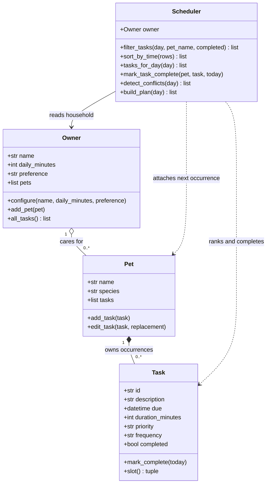

# PawPal+

A daily care planner for a multi-pet household. Record feedings, walks, medications, grooming, and appointments. The **agenda** shows everything entered. The **plan** recommends which pending tasks fit the owner's time and explains what was deferred. A deferred task is not deleted, completed, or automatically rescheduled.

## Getting started

Use Python 3.10 or newer. From the project folder, create an isolated environment:

```sh
python -m venv .venv
```

Activate with `source .venv/bin/activate` on macOS/Linux, `.venv\Scripts\activate.bat` in Windows Command Prompt, or `.\.venv\Scripts\Activate.ps1` in PowerShell. Then run:

```sh
python -m pip install -r requirements.txt
python main.py
python -m pytest
python -m streamlit run app.py
```

On Windows, `py` can replace `python` to create the virtual environment. On macOS/Linux, use `python3` when `python` is not installed. The CLI itself needs only Python's standard library. The web app needs Streamlit; no API key or cloud account is required. Data survives widget reruns, **not a new browser session or server restart**. The app does not send reminders or make medical decisions.

## Features

Register an owner and multiple pets; add or edit pending care with a duration, priority, and repeat rule; filter a chronological agenda; view conflict warnings; generate a daily plan; and complete a task without losing its history. The recommended plan updates automatically when the schedule or settings change.

## Demo Walkthrough

1. Open **Household**. Enter `Jordan`, set the daily budget to **25 minutes**, leave **earlier first**, and save. Add **Mochi** (dog) and **Pip** (cat), separately.
2. Open **Care tasks**. Add the four entries below for today's date. Enter the evening walk first to test whether display order depends on entry order.

   | Pet | Task | Start | Minutes | Priority | Frequency |
   |---|---|---:|---:|---|---|
   | Mochi | Evening walk | 18:00 | 25 | low | once |
   | Mochi | Breakfast | 08:00 | 10 | high | daily |
   | Pip | Brush coat | 12:00 | 10 | medium | weekly |
   | Pip | Puzzle feeder | 08:00 | 10 | low | once |

3. Open **Daily schedule**. The agenda starts at 08:00 and a warning names both tasks at that time. The plan chooses Breakfast and Brush coat (20 minutes). Puzzle feeder conflicts; the 25-minute walk cannot fit the five remaining minutes.
4. Filter by **Mochi** and select **Breakfast** under *Occurrence to complete*. Click **Mark complete**. Filter by **Completed** to see today's record; switch to tomorrow and **Pending** to see the next breakfast. Warnings and the plan always use the whole household, even when the agenda has a pet filter.
5. To revise an activity, open **Care tasks → Pip → Edit**, choose Puzzle feeder, change its start to **08:10** and duration to **5**, and save. Return to today's agenda. It now fits immediately after breakfast; the tasks touch but do not overlap. Editing an occurrence keeps its ID; completed records cannot be edited.

### Sample Output

Actual output from `python main.py` (the date follows the machine's local date):

```text
Today's Schedule | 2026-11-22 | Jordan
08:00  Mochi  Breakfast      10 min  high
08:00  Pip    Puzzle feeder  10 min  low
12:00  Pip    Brush coat     10 min  medium
18:00  Mochi  Evening walk   25 min  low

Warnings
08:00 conflict — Mochi: Breakfast; Pip: Puzzle feeder

Daily plan | 25 minutes
Plan   08:00  Mochi: Breakfast — High priority; fits time and budget.
Defer  08:00  Pip: Puzzle feeder — Overlaps a reserved time slot.
Plan   12:00  Pip: Brush coat — Medium priority; fits time and budget.
Defer  18:00  Mochi: Evening walk — Needs 25 min; only 5 min left.

Completed for Mochi today:
08:00  Breakfast
Next: Mochi — Breakfast on 2026-11-23 at 08:00 (pending)
```

## Smarter Scheduling

| Behavior | Implemented by | Rule |
|---|---|---|
| Chronological agenda | `Scheduler.sort_by_time()`, `tasks_for_day()` | Sort a copy by full date and time. Keep the original order of exact ties. |
| Filters | `Scheduler.filter_tasks()` | Date, pet name and completion status can be combined; an unset filter includes all values. |
| Conflict warnings | `Scheduler.detect_conflicts()` | One warning per shared start minute for pending tasks, within or across pets. Different dates are separate. |
| Priority and time budget | `Scheduler.build_plan()`, `Task.slot()` | Reserve time and minutes for completed tasks. Consider high, medium, then low priority. Respect earlier/shorter preference on ties. Defer a task if its fixed time overlaps a reservation or it exceeds the remaining budget. Return all decisions in time order. |
| Recurrence | `Scheduler.mark_task_complete()`, `Task.mark_complete()` | Mark the original complete. A repeating task produces one new pending occurrence for the same pet, at the same clock time. Repeating the completion is a no-op. |
| Task edits | `Pet.edit_task()` | Validate a replacement before changing the original. Keep its ID and its pet. |

**Calendar rules.** For daily/weekly care, add 1/7 calendar days to the later of the due date and completion date. This prevents an overdue task from generating another overdue task. Completing a weekly task late therefore shifts its weekday. Early completion does not pull the next due date earlier. Only the next occurrence is created; the app does not prepopulate an entire series. Times are household-local, in whole minutes. Tasks may finish at midnight but not span into the next day.

**Why two conflict checks?** The agenda flags equal starts without blocking entry. The planner also checks partial overlaps using `[start, end)`, so 08:00–08:10 and 08:10–08:15 both fit. The planner never changes an entered time. Priority-first selection is explainable but does not maximize the number of tasks completed.

## Testing PawPal+

```sh
python -m pytest
```

Five test goals: (1) isolate pets and preserve task identity; (2) sort/filter without changing records; (3) complete and repeat exactly once; (4) detect conflicts and respect budget, priority, and preferences; (5) drive the same model through interface actions. Cases include an empty household, zero budget, a weekly task crossing New Year, adjacent slots, and completing a task late or twice.

**Confidence level: 4/5 for this prototype.** The backend and form handlers were exercised. The build environment did not contain Streamlit, so its native integration test was skipped, not counted as a pass. After installing the requirements, run `python -m pytest -v tests/test_streamlit.py` to exercise Streamlit itself. The separate form-handler test uses simulated controls; it does not verify browser rendering.

Actual output from `python -m pytest` in the build environment:

```text
============================= test session starts ==============================
platform linux -- Python 3.13.5, pytest-9.0.2, pluggy-1.6.0
rootdir: /mnt/data/pawpal-work/project
configfile: pytest.ini
testpaths: tests
plugins: anyio-4.13.0, ddtrace-4.4.0, Faker-40.1.2, asyncio-1.3.0, cov-7.0.0, json-report-1.5.0, metadata-3.1.1
asyncio: mode=Mode.STRICT, debug=False, asyncio_default_fixture_loop_scope=None, asyncio_default_test_loop_scope=function
collected 27 items

tests/test_pawpal.py .........................                           [ 92%]
tests/test_streamlit.py s                                                [ 96%]
tests/test_ui_wiring.py .                                                [100%]

=========================== short test summary info ============================
SKIPPED [1] tests/test_streamlit.py:8: Install requirements.txt for the native Streamlit integration test.
======================== 26 passed, 1 skipped in 0.07s =========================
```

## Architecture and project files

`app.py` and `main.py` both import `pawpal_system.py`. The owner holds pets, each pet holds its occurrences, and the scheduler reads the owner's records. There is no independent UI copy of the task list. See the [draft UML](diagrams/uml_draft.mmd), [final UML](diagrams/uml_final.mmd), [project reflection](reflection.md), and [AI interactions log](ai_interactions.md). `diagrams/uml.mmd` mirrors the final source for tools expecting the starter filename.


